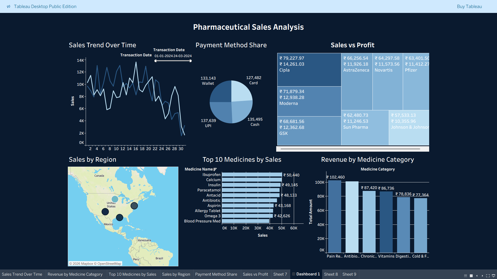

# Pharmaceutical Sales Analysis

## 📌 Project Overview

The **Pharmaceutical Sales Analysis** project focuses on analyzing pharmaceutical sales data to understand sales performance, revenue distribution, product performance, and regional trends.

The project uses Tableau to transform sales data into visualizations that help identify patterns, compare performance across categories and regions, and support data-driven business decisions.

The analysis explores sales trends, revenue by product category, regional performance, payment methods, top-performing medicines, and the relationship between sales and profit, where supported by the available dataset.

## 🎯 Project Objectives

- Analyze pharmaceutical sales trends over time.
- Evaluate revenue performance across product categories.
- Compare sales performance across regions.
- Identify top-performing medicines based on sales.
- Examine payment method distribution.
- Explore the relationship between sales and profit.
- Present key findings through interactive Tableau visualizations.

## 📊 Dashboard Preview



## 🛠️ Tools and Technologies

| Tool / Technology | Purpose |
|---|---|
| Tableau | Data visualization and dashboard development |
| Microsoft Excel | Data inspection and preparation, if used |
| Data Cleaning | Preparing data for reliable analysis, if performed |
| Exploratory Data Analysis (EDA) | Exploring patterns and trends in the dataset |

*Only retain the tools and activities that you actually used in this project.*

## 📁 Dataset

The project uses pharmaceutical sales data to analyze product sales, revenue, and related business performance indicators.

The analysis may include the following dimensions, depending on the available dataset:

- Sales date
- Medicine or product name
- Product category
- Sales amount or revenue
- Region or location
- Payment method
- Profit, if available

**Dataset file:** See the `dataset/` folder.

**Dataset source:** Add the original dataset source and URL here.

The dataset should be documented accurately so that viewers can understand its origin and scope.

## 🔄 Project Workflow

### 1. Data Understanding
Examined the available dataset to understand its structure, fields, and suitability for pharmaceutical sales analysis.

### 2. Data Preparation
Prepared the dataset for analysis, including cleaning or correcting data where necessary.

### 3. Exploratory Data Analysis
Explored sales patterns and compared performance across available product, category, regional, and time dimensions.

### 4. Data Visualization
Used Tableau to build visualizations that present sales performance and related trends.

### 5. Dashboard Development
Organized relevant visualizations into a dashboard to make the analysis easier to explore.

### 6. Insight Generation
Interpreted the visualizations to identify meaningful patterns in pharmaceutical sales performance.

## 🔍 Key Areas of Analysis

### 1. Sales Trend Analysis
Examines changes in pharmaceutical sales over time and helps identify periods of higher or lower sales activity.

### 2. Category-Wise Revenue Analysis
Compares revenue across available pharmaceutical product categories.

### 3. Regional Sales Performance
Evaluates sales performance across regions or locations represented in the dataset.

### 4. Top-Selling Medicines
Identifies medicines that perform strongly based on the selected sales metric.

### 5. Payment Method Analysis
Explores how transactions are distributed across available payment methods.

### 6. Sales and Profit Analysis
Examines the relationship between sales and profit if both measures are available in the dataset.

## 💡 Key Insights

Add the most important findings from your actual dashboard in this section.

For each finding, describe:
- What the dashboard shows.
- Which category, region, product, or period stands out.
- What the finding means from a business perspective.

Examples of insight formats:

- **Sales Trends:** Identify the periods with the highest and lowest sales.
- **Category Performance:** Highlight the product category generating the most revenue.
- **Regional Performance:** Identify regions with comparatively high or low sales.
- **Product Performance:** Highlight the best-performing medicines based on the selected metric.
- **Payment Methods:** Identify the most frequently used payment methods, if this information is available.
- **Profitability:** Explain the relationship between sales and profit, if analyzed.

*Replace these examples with specific, verified findings from your dashboard before publishing.*

## 📂 Project Structure

```text
Pharmaceutical-Sales-Analysis/
│
├── dashboard/
│   └── Pharmaceutical_Sales_Analysis.twbx
│
├── dataset/
│   └── pharmaceutical_sales_dataset.xlsx
│
├── screenshots/
│   └── dashboard.png
│
├── presentation/
│   └── Pharmaceutical_Sales_Analysis.pptx
│
└── README.md
```

*Update the filenames and folders above to match your actual repository.*

## 🚀 How to View the Dashboard

1. Clone or download this repository.
2. Install Tableau Desktop or use another compatible Tableau viewing option.
3. Navigate to the `dashboard/` folder.
4. Open the packaged Tableau workbook (`.twbx`).
5. Explore the available visualizations and dashboard filters.
6. Refer to the `screenshots/` folder for the dashboard preview.
7. Refer to the `presentation/` folder for additional project documentation, if included.

**Note:** Opening a workbook may require a compatible Tableau application. Data refresh may also depend on the workbook's data connections.

## 📄 Project Files

| File or Folder | Description |
|---|---|
| `dashboard/` | Tableau workbook |
| `dataset/` | Dataset used for the analysis, if shareable |
| `screenshots/` | Dashboard screenshots |
| `presentation/` | Project presentation, if included |
| `README.md` | Project documentation |

## 💼 Skills Demonstrated

- Data Analysis
- Exploratory Data Analysis
- Data Visualization
- Dashboard Development
- Sales Performance Analysis
- Trend Analysis
- Comparative Analysis
- Business Insight Generation

*Retain only the skills demonstrated by your actual project work.*

## 👤 Author

**Muhammed Sinan T. A.**

GitHub: [muhammedsinanta](https://github.com/muhammedsinanta)

---

*This project is part of my data analytics portfolio and demonstrates the use of data analysis and visualization to explore pharmaceutical sales performance.*
